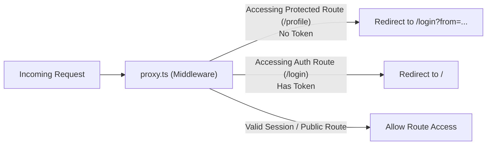

# Next.js Client Boilerplate (ClientHub)

[](https://nextjs.org/)
[](https://react.dev/)
[](https://www.typescriptlang.org/)
[](https://tailwindcss.com/)
[](https://ui.shadcn.com/)
[](https://base-ui.com/)
[](https://zustand.docs.pmnd.rs/)
[](https://www.docker.com/)
[](https://turbo.build/pack)
[](LICENSE)

A production-ready, performant, enterprise-grade client boilerplate built with **Next.js 16 (App Router & Turbopack)**, **React 19**, **Tailwind CSS v4**, **TypeScript 5**, and **shadcn UI (Base UI primitives)**. Designed from the ground up for modern marketing landing pages, customer-facing portals, SaaS web applications, and high-performance digital experiences.

Pairs seamlessly with [**nextjs-admin-boilerplate**](https://github.com/aashish-bhandari-dev/nextjs-admin-boilerplate) or standalone REST / GraphQL backends.

---

## Table of Contents

- [Key Features](#key-features)
- [Tech Stack](#tech-stack)
- [Architecture & Directory Structure](#architecture--directory-structure)
- [Authentication & Route Guarding](#authentication--route-guarding)
- [Getting Started](#getting-started)
  - [Prerequisites](#prerequisites)
  - [Installation](#installation)
  - [Environment Configuration](#environment-configuration)
  - [Running the Application](#running-the-application)
- [Docker & Containerization](#docker--containerization)
  - [Production Mode (Docker Compose)](#1-production-mode-docker-compose)
  - [Development Mode (Hot Reloading)](#2-development-mode-hot-reloading)
  - [Standalone Docker CLI](#3-standalone-docker-cli)
- [Component Library & UI Primitives](#component-library--ui-primitives)
- [Theming & Zero-Flash Dark Mode](#theming--zero-flash-dark-mode)
- [Available Scripts](#available-scripts)
- [CI/CD & Code Standards](#cicd--code-standards)
- [License](#license)

---

## Key Features

### 🚀 Modern Architecture

- **Next.js 16 App Router & Turbopack**: Blazing-fast compilation, optimized bundling, and standalone build output for minimal container images.
- **React 19 Foundation**: Full support for React Server Components (RSC), async transitions, and hydration streaming.
- **Tailwind CSS v4 & OKLCH**: Modern pure CSS `@theme inline` tokens, wide-gamut OKLCH palettes, and zero JavaScript config overhead.

### 🔐 Complete Authentication Suite

- **Prebuilt Auth Flows**: Dedicated pages for Login, Registration, Forgot Password, Reset Password, and Email Verification.
- **User Profile Management**: Authenticated user profile dashboard with form editing and account status display.
- **Route Protection (`proxy.ts`)**: Built-in Next.js proxy middleware enforcing authenticated access to protected routes (`/profile`, `/settings`, `/dashboard`) and redirecting logged-in users away from auth pages.
- **Schema Validation**: Robust request and form validation powered by **Zod**.
- **Repository Pattern**: Clean separation of data operations in `repo/auth.repo.ts` decoupling UI components from network calls.

### 🌐 Enterprise Networking & State

- **Dual Axios Clients**:
  - `client-api.ts`: Client-side Axios instance with automatic Bearer token injection from cookies and automatic 401 token cleanup.
  - `server-api.ts`: Server-side API utility extracting tokens directly from `next/headers` for React Server Components.
- **State Management**: Lightweight, reactive stores built with **Zustand 5**, including cookie-synced authentication state and persistent UI states.

### 🎨 Modular & Accessible UI

- **shadcn UI & Base UI Primitives**: 16+ accessible, composable atomic components (`button`, `card`, `dialog`, `dropdown-menu`, `input`, `avatar`, `toaster`, `tooltip`, `table`, `popover`, `date-picker`, etc.).
- **Interactive Landing Page Layout**:
  - **Announcement Banner**: Dismissible notice banner above navigation.
  - **Header / Navbar**: Sticky blurred backdrop, dropdown menus with icon lists, search modal trigger, GitHub badge, theme toggle, and mobile responsive drawer.
  - **Hero Section**: High-converting typography, CTA buttons, and interactive terminal snippet with one-click copy.
  - **Stats Section**: Performance and operational metrics counters.
  - **Features Grid**: Filterable category cards with icons and highlight checklists.
  - **Interactive Component Showcase**: Live test widgets for buttons, inputs, switches, dropdowns, and toast notifications.
  - **How It Works**: Step-by-step developer onboarding walkthrough.
  - **Testimonials & Social Proof**: Customer reviews, star ratings, and avatars.
  - **Pricing Section**: Tiered subscription plans with monthly/yearly billing toggle.
  - **FAQ Section**: Accessible disclosure accordions.
  - **CTA Banner**: Radiant gradient banner driving conversions.
  - **Footer**: Newsletter subscription box with real-time feedback, category links, live operational status pill, and social links.

### 🌓 Complete Theme Engine

- **Zero-Flash Theme System**: `ThemeProvider` supporting System, Light, and Dark modes via `useSyncExternalStore` for clean SSR hydration without flash of unstyled content (FOUC).
- **Animated Theme Toggle**: Dropdown selector with Sun, Moon, and System options.

### 🐳 Production-Ready Docker Workflows

- **Multi-Stage Dockerfile**: Multi-stage Alpine containerization with separate stages for dependencies (`deps`), live development (`dev`), production building (`builder`), and minimal runtime (`runner`).
- **Docker Compose**: Out-of-the-box configurations for both background production deployment and live-reloading local development.

---

## Tech Stack

| Layer                    | Technology                                                           | Description                                                |
| ------------------------ | -------------------------------------------------------------------- | ---------------------------------------------------------- |
| **Framework**            | [Next.js 16](https://nextjs.org/)                                    | App Router, Turbopack, Standalone Output                   |
| **Library**              | [React 19](https://react.dev/)                                       | React Server Components & Streaming                        |
| **Language**             | [TypeScript 5](https://www.typescriptlang.org/)                      | Strict Type Safety & Path Aliasing                         |
| **Styling**              | [Tailwind CSS v4](https://tailwindcss.com/)                          | Pure CSS `@theme inline` & OKLCH color spaces              |
| **Animations**           | [tw-animate-css](https://www.npmjs.com/package/tw-animate-css)       | Micro-interactions and transition utilities                |
| **Component Primitives** | [Base UI](https://base-ui.com/), [shadcn UI](https://ui.shadcn.com/) | Unstyled, accessible primitives (`base-nova`)              |
| **State Management**     | [Zustand 5](https://zustand.docs.pmnd.rs/)                           | Lightweight, decoupled global stores                       |
| **Validation**           | [Zod 4](https://zod.dev/)                                            | Type-safe form and payload validation schemas              |
| **HTTP Client**          | [Axios](https://axios-http.com/)                                     | Interceptor-driven HTTP client with bearer tokens          |
| **Storage / Cookies**    | [js-cookie](https://github.com/js-cookie/js-cookie)                  | Client-side cookie management                              |
| **Icons**                | [Lucide React](https://lucide.dev/)                                  | Modern, consistent icon library                            |
| **Code Quality**         | ESLint 9, Prettier 3                                                 | Automated linting and formatting                           |
| **Containerization**     | Docker & Docker Compose                                              | Multi-stage Alpine container with healthchecks             |
| **CI/CD**                | GitHub Actions                                                       | Automated lint, format, type-check, and build verification |

---

## Architecture & Directory Structure

```text
├── .github/
│   ├── workflows/
│   │   └── ci.yml                    # Automated GitHub Actions CI workflow
│   └── pull_request_template.md      # Pull request description & checklist template
├── .vscode/
│   ├── extensions.json               # Recommended VS Code extensions
│   └── settings.json                 # Formatter, ESLint fix-on-save, and Tailwind class regex
├── app/
│   ├── (auth)/                       # Authentication route group (unauthenticated layout)
│   │   ├── forgot-password/page.tsx  # Password reset request page
│   │   ├── login/page.tsx            # Login credentials page
│   │   ├── register/page.tsx         # User registration page
│   │   ├── reset-password/page.tsx   # Password recovery confirmation page
│   │   ├── verify-email/page.tsx     # Email OTP/token verification page
│   │   └── layout.tsx                # Auth shell layout with split showcase panel
│   ├── profile/
│   │   └── page.tsx                  # Authenticated user profile dashboard
│   ├── favicon.ico                   # Application favicon
│   ├── globals.css                   # Tailwind CSS v4 variables & OKLCH tokens
│   ├── layout.tsx                    # Root HTML layout with fonts & ThemeProvider
│   └── page.tsx                      # Primary home page composing ClientLayout & HomeView
├── components/
│   ├── auth/                         # Authentication domain components & views
│   ├── home/                         # Home page marketing sections (Hero, Features, Pricing, etc.)
│   ├── icons/                        # Custom SVG brand icons (GitHub, Twitter/X, Google)
│   ├── layout/                       # App layout shell (Navbar, AnnouncementBanner, Footer)
│   ├── theme/                        # Theme system (ThemeProvider & ThemeToggle)
│   └── ui/                           # 16+ atomic shadcn / Base UI primitives
├── config/
│   └── site.ts                       # Centralized site metadata & navigation menu structure
├── hooks/
│   └── use-mobile.ts                 # Responsive mobile viewport hook
├── lib/
│   ├── api/
│   │   ├── client-api.ts             # Axios client with bearer interceptors & 401 handler
│   │   └── server-api.ts             # Server-side API utility using next/headers cookies
│   └── utils.ts                      # Class merging utility (cn)
├── repo/
│   ├── auth.repo.ts                  # Auth repository encapsulating API calls
│   └── index.ts                      # Repository exports
├── schemas/
│   ├── auth.schema.ts                # Zod validation schemas for authentication forms
│   └── index.ts                      # Schema exports
├── store/
│   ├── auth.store.ts                 # Zustand persistent authentication store
│   ├── sidebar.store.ts              # Persistent responsive sidebar state
│   └── index.ts                      # Store exports
├── types/
│   ├── auth.types.ts                 # TypeScript interfaces for authentication & user payloads
│   ├── base.types.ts                 # Base API response structures & common models
│   ├── user.types.ts                 # User profile models
│   └── index.ts                      # Type exports
├── .dockerignore                     # Docker build context exclusions
├── .editorconfig                     # Universal cross-editor configuration
├── .env.example                      # Documented environment variable template
├── .gitattributes                    # Git line-ending normalization & diff driver rules
├── .gitignore                        # Git exclusion rules
├── .node-version                     # Node.js version pinning (v22) for fnm/asdf/mise
├── .nvmrc                            # Node.js version pinning (v22) for nvm
├── .prettierignore                   # Prettier formatting exclusions
├── .prettierrc                       # Prettier code formatting rules
├── Dockerfile                        # Multi-stage Docker build (dev, builder, runner)
├── docker-compose.yml                # Production Docker Compose orchestration
├── docker-compose.dev.yml            # Development Docker Compose orchestration with hot reload
├── eslint.config.mjs                 # Flat ESLint 9 configuration
├── next.config.ts                    # Next.js standalone output & API proxy rewrites
├── package.json                      # Project dependencies, engines, and run scripts
├── proxy.ts                          # Next.js route protection & redirect middleware
└── tsconfig.json                     # TypeScript strict configuration & path aliases
```

---

## Authentication & Route Guarding

This boilerplate includes an enterprise authentication architecture:



- **Tokens & Storage**: Auth tokens (`access_token`, `refresh_token`, `user_role`) are persisted in secure cookies using `js-cookie`.
- **Client Interceptor**: `lib/api/client-api.ts` automatically attaches `Authorization: Bearer <token>` to outbound requests and cleanly purges credentials on `401 Unauthorized`.
- **Server Requests**: `lib/api/server-api.ts` provides server components direct access to authenticated endpoints by reading cookies via `next/headers`.

---

## Getting Started

### Prerequisites

- **Node.js**: `v20.x` or `v22.x` (Recommended: `v22` LTS via `.nvmrc`)
- **Package Manager**: `npm` (>= 9.0.0), `pnpm`, or `yarn`
- **Docker**: _(Optional)_ Docker Engine and Docker Compose for containerized execution

### Installation

1. **Clone the repository:**

   ```bash
   git clone https://github.com/aashish-bhandari-dev/nextjs-client-boilerplate.git
   cd nextjs-client-boilerplate
   ```

2. **Use the specified Node version:**

   ```bash
   nvm use
   ```

3. **Install dependencies:**
   ```bash
   npm install
   ```

### Environment Configuration

Copy the example environment configuration file:

```bash
cp .env.example .env
```

| Variable               | Default Value           | Description                                      |
| ---------------------- | ----------------------- | ------------------------------------------------ |
| `NODE_ENV`             | `development`           | Environment mode (`development` or `production`) |
| `NEXT_PUBLIC_APP_NAME` | `ClientHub`             | Branding title displayed across UI and metadata  |
| `NEXT_PUBLIC_APP_URL`  | `http://localhost:3000` | Canonical frontend application URL               |
| `NEXT_PUBLIC_API_URL`  | `http://localhost:5001` | Target backend REST API endpoint                 |

### Running the Application

Start the local development server with Turbopack:

```bash
npm run dev
```

Open [http://localhost:3000](http://localhost:3000) in your browser.

---

## Docker & Containerization

### 1. Production Mode (Docker Compose)

Builds the optimized multi-stage standalone image and launches the production service with automated health checks:

```bash
# Build and run containers in detached mode
docker compose up -d --build

# View real-time container logs
docker compose logs -f

# Stop and remove containers
docker compose down
```

### 2. Development Mode (Hot Reloading)

Runs the application inside a container while bind-mounting the host filesystem for live Turbopack reloads:

```bash
docker compose -f docker-compose.dev.yml up --build
```

### 3. Standalone Docker CLI

```bash
# Build the production image
npm run docker:build

# Run the container with environment file injection
npm run docker:run
```

---

## Component Library & UI Primitives

All UI components in `components/ui/` are built on `@base-ui/react` primitives and styled with Tailwind CSS v4 OKLCH tokens:

| Component            | Description                                                                                       |
| -------------------- | ------------------------------------------------------------------------------------------------- |
| **Button**           | 6 design variants (`default`, `secondary`, `outline`, `ghost`, `destructive`, `link`) and 8 sizes |
| **Card**             | Composable cards (`CardHeader`, `CardTitle`, `CardDescription`, `CardContent`, `CardFooter`)      |
| **Dialog & Popover** | Accessible modal dialogues and floating context panels                                            |
| **DropdownMenu**     | Accessible menus with menu items, separators, sub-menus, and shortcuts                            |
| **Form Controls**    | Accessible `Input`, `Label`, `Checkbox`, `Switch`, and `DatePicker`                               |
| **Toaster & Toast**  | Global notification dispatcher with success, error, warning, and info variants                    |
| **Avatar & Badge**   | User presence avatars and categorical status badges                                               |
| **Sidebar & Table**  | Collapsible navigation sidebars and structured data tables                                        |

---

## Theming & Zero-Flash Dark Mode

The project features a hydration-safe theme provider:

- **`ThemeProvider`** leverages React 19 `useSyncExternalStore` to synchronize the theme across DOM attributes and local storage without triggering hydration mismatch errors.
- **`ThemeToggle`** offers instant switching between Light, Dark, and System preferences.
- Uses wide-gamut OKLCH CSS variables in `app/globals.css` that dynamically adapt between light and dark modes.

---

## Available Scripts

| Script                 | Command                                                             | Description                                          |
| ---------------------- | ------------------------------------------------------------------- | ---------------------------------------------------- |
| `npm run dev`          | `next dev --turbopack`                                              | Starts local dev server with Turbopack               |
| `npm run build`        | `next build --webpack`                                              | Compiles optimized production bundle                 |
| `npm run start`        | `next start`                                                        | Starts production server                             |
| `npm run lint`         | `eslint`                                                            | Analyzes code for quality and style issues           |
| `npm run type-check`   | `tsc --noEmit`                                                      | Validates TypeScript types across the codebase       |
| `npm run format`       | `prettier --write .`                                                | Automatically formats all codebase files             |
| `npm run format:check` | `prettier --check .`                                                | Verifies that all files conform to formatting rules  |
| `npm run validate`     | `npm run lint && npm run type-check && npm run format:check`        | Complete pre-commit / CI verification pass           |
| `npm run docker:build` | `docker build -t nextjs-client-boilerplate .`                       | Builds standalone production Docker image            |
| `npm run docker:run`   | `docker run -p 3000:3000 --env-file .env nextjs-client-boilerplate` | Runs standalone Docker container                     |
| `npm run docker:up`    | `docker compose up -d`                                              | Starts background Docker Compose production services |
| `npm run docker:down`  | `docker compose down`                                               | Stops Docker Compose services                        |
| `npm run docker:dev`   | `docker compose -f docker-compose.dev.yml up`                       | Launches Docker Compose development environment      |

---

## CI/CD & Code Standards

- **GitHub Actions Workflow (`.github/workflows/ci.yml`)**: Automatically triggers on pushes and pull requests to `main`, validating linting, formatting, TypeScript types, and production compilation.
- **Prettier & EditorConfig**: Enforces 2-space indentation, semicolons, double quotes, and trailing commas across all IDEs.
- **Git Attributes (`.gitattributes`)**: Automatically normalizes cross-platform line endings to `LF` to eliminate carriage return diffs across Windows, macOS, and Linux.

---

## License

Distributed under the MIT License. See [LICENSE](LICENSE) for more information.

Copyright (c) 2026 Aashish Bhandari
